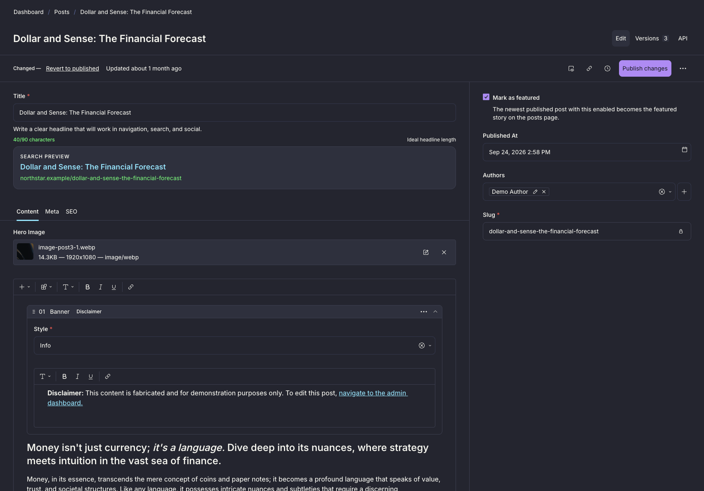
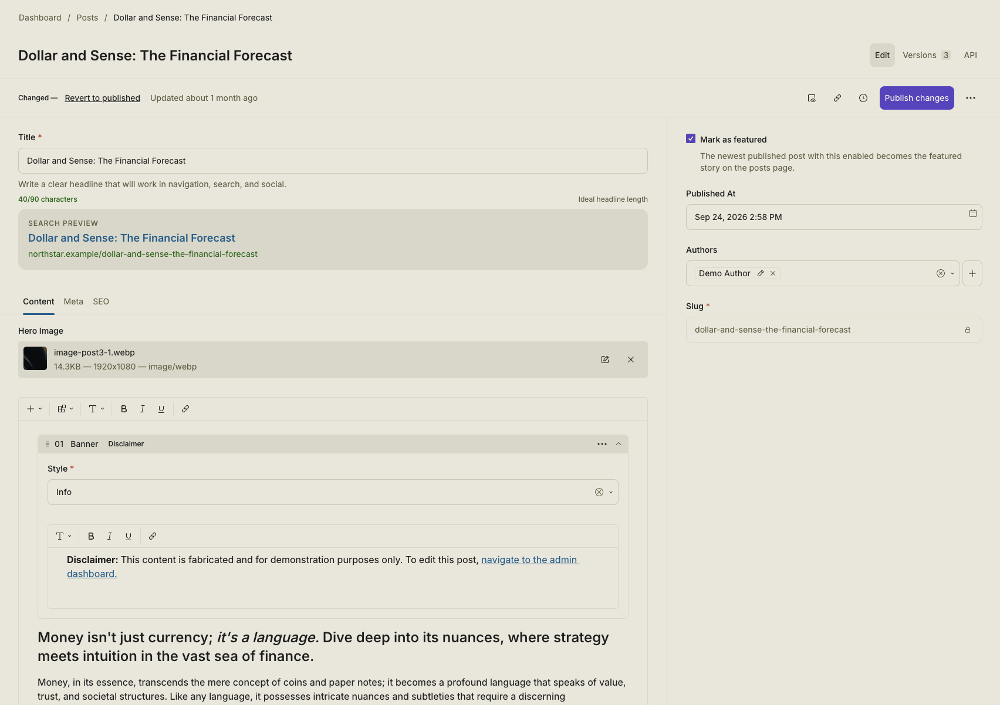
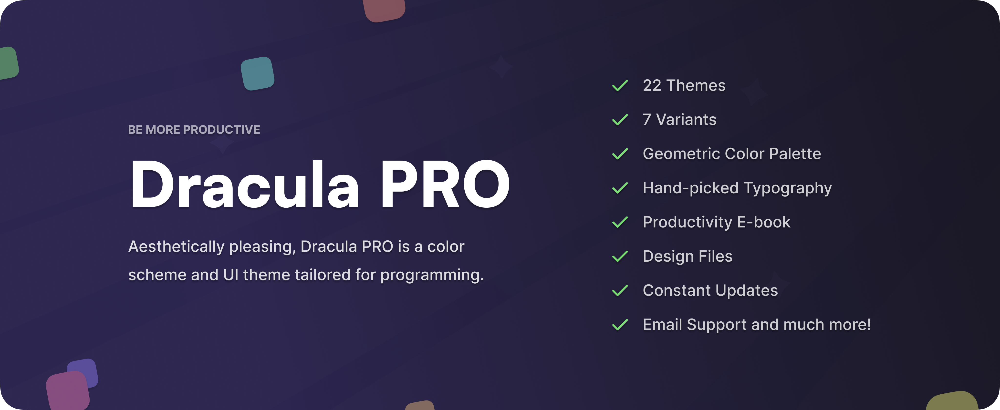

# Dracula for [Payload](https://payloadcms.com)

> A Dracula and Alucard theme for the [Payload](https://payloadcms.com) Admin UI.

Dark mode uses Dracula Classic. Light mode uses its official Alucard Classic companion.

## Install

All instructions can be found at [draculatheme.com/payload](https://draculatheme.com/payload).

## Team

This theme is maintained by the following person and a bunch of [awesome contributors](https://github.com/dracula/payload/graphs/contributors).

|  |
| ----------------------------------------------------------------------------------------- |
| [Sean Zubrickas](https://github.com/zubricks)                                             |

## Community

Join thousands of vampires using Dracula Theme around the world 🦇

- [X (Twitter)](https://x.com/draculatheme) and [Instagram](https://www.instagram.com/draculatheme) - Follow for tips, news, and fun.
- [Discord](https://draculatheme.com/discord-invite) - Hang out and chat with the rest of the clan.
- [GitHub Discussions](https://github.com/dracula/dracula-theme/discussions) - Ask questions and discuss issues.

## Dracula PRO

## License

[MIT License](./LICENSE)
